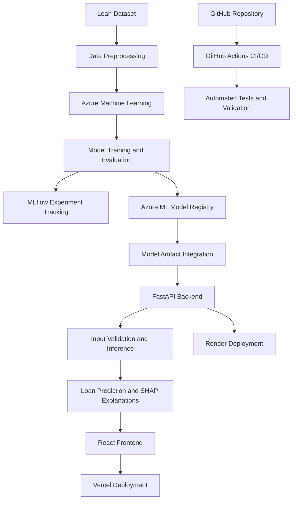

# Intelligent Loan Approval System with Azure ML MLOps

An end-to-end Machine Learning Operations (MLOps) project that combines predictive analytics, explainable AI, automated model training, experiment tracking, and CI/CD to streamline loan approval risk assessment.

Built using **Azure Machine Learning, MLflow, FastAPI, React, and GitHub Actions**, the system demonstrates a scalable and modular approach to developing, validating, deploying, and serving machine learning models.

## Overview

Financial institutions need reliable and consistent ways to evaluate loan applications. Manual assessment processes can be time-consuming, difficult to scale, and susceptible to inconsistent decision-making.

The Intelligent Loan Approval System uses machine learning to analyze applicant information and predict loan approval outcomes. It integrates MLOps practices to support reproducible experiments, model versioning, automated validation, and deployment workflows.

The project separates model development and training from application inference, allowing computationally intensive ML workloads to run in Azure Machine Learning while a lightweight web application provides an interactive user experience.

## Key Features

- **Automated Loan Prediction:** Predicts loan approval outcomes using applicant financial and demographic attributes.
- **Explainable AI (XAI):** Integrates SHAP to help interpret model predictions and identify influential features.
- **Experiment Tracking:** Uses MLflow to track model training experiments, parameters, metrics, and artifacts.
- **Model Versioning:** Uses Azure Machine Learning model registry capabilities to organize and manage model versions.
- **Automated ML Workflows:** Supports repeatable data preprocessing, model training, evaluation, and validation.
- **CI/CD Integration:** Uses GitHub Actions to automate configured testing and validation workflows.
- **REST API:** Provides model inference through a FastAPI backend with input validation.
- **Interactive Dashboard:** Offers a React-based interface for submitting applicant details and viewing predictions.
- **Cloud Deployment:** Uses Render and Vercel for backend and frontend hosting, respectively, where configured.

## Architecture

The project follows a modular architecture that separates model development, model serving, and user interaction.

### Architecture Components

| Component | Responsibility |
|---|---|
| Azure Machine Learning | Model development, training, evaluation, and ML lifecycle management |
| MLflow | Experiment tracking, metric logging, and artifact management |
| Azure ML Model Registry | Model registration and version management |
| GitHub Actions | Automated testing and CI/CD workflows |
| FastAPI | REST API, request validation, and model inference |
| SHAP | Interpretation of model predictions and feature contributions |
| React | Interactive frontend and prediction dashboard |
| Render | Backend application hosting |
| Vercel | Frontend application hosting |

## Technology Stack

| Category | Technologies |
|---|---|
| Programming Language | Python, JavaScript/TypeScript, as applicable |
| Machine Learning | pandas, NumPy, scikit-learn |
| MLOps | Azure Machine Learning, MLflow |
| Explainable AI | SHAP |
| Backend | FastAPI, Uvicorn |
| Frontend | React |
| CI/CD | GitHub Actions |
| Model Management | Azure ML Model Registry |
| Cloud Hosting | Render, Vercel |
| Version Control | Git, GitHub |

## MLOps Workflow

The ML lifecycle is organized into the following stages:

1. **Data Preparation:** Load the loan dataset, inspect data quality, handle missing values, and preprocess categorical and numerical features.
2. **Model Training:** Train a classification model to predict loan approval outcomes.
3. **Model Evaluation:** Evaluate the model using appropriate classification metrics, such as accuracy, precision, recall, F1-score, and ROC-AUC where applicable.
4. **Experiment Tracking:** Log relevant parameters, metrics, and model artifacts using MLflow.
5. **Model Registration:** Register evaluated models in Azure Machine Learning for version management.
6. **Automated Validation:** Run configured tests and validation checks through GitHub Actions.
7. **Model Serving:** Load the selected model into a FastAPI application and expose a prediction endpoint.
8. **Explainability:** Generate SHAP-based explanations to help users understand the factors contributing to predictions.
9. **Application Deployment:** Deploy the backend and frontend independently using Render and Vercel.

*Note: The workflow describes the intended end-to-end architecture. Individual stages depend on the corresponding pipeline, workflow, and deployment configurations being implemented.*

## Explainable AI

Model predictions are more useful when users can understand the factors influencing them.

The project incorporates SHAP (SHapley Additive exPlanations) to support model interpretability at two levels:

- **Global Explainability:** Understand which features influence model predictions across a dataset.
- **Local Explainability:** Examine how individual applicant features contribute to a specific prediction.

Potential explanatory features include credit history, applicant income, loan amount, loan term, and other attributes available in the training dataset.

SHAP explanations describe model behavior; they do not establish that a prediction is objectively correct or that a particular applicant should be approved or rejected.

### 6. Configure Azure ML

For cloud-based model training and experiment tracking:

1. Create or select an Azure Machine Learning workspace.
2. Configure authentication using an approved Azure identity.
3. Set up the required compute resources and data assets.
4. Configure the training workflow to log experiments through MLflow.
5. Register evaluated models in the Azure ML model registry.
6. Verify workspace permissions and model artifact access before deployment.

Avoid embedding Azure credentials, client secrets, or access tokens in source code.

## Model Evaluation

Evaluate the classifier using a consistent holdout dataset and metrics suited to the problem.

| Metric | Purpose |
|---|---|
| Accuracy | Measures the overall proportion of correct predictions |
| Precision | Measures how many predicted positive cases are actually positive |
| Recall | Measures how many actual positive cases are identified |
| F1-score | Balances precision and recall |
| ROC-AUC | Measures ranking discrimination when the evaluation setup supports it |
| Confusion Matrix | Summarizes correct and incorrect classifications |

The positive class must be defined explicitly when interpreting precision and recall. In a lending context, the implications of false approvals and false rejections can differ substantially.

Actual model scores should be reported only after evaluation; no performance figures are assumed in this README.

## Deployment

The project separates model development from web application hosting.

- **Azure Machine Learning:** Used for cloud-based model development, experiment tracking, and model management.
- **Render:** Intended for hosting the FastAPI backend.
- **Vercel:** Intended for hosting the React frontend.
- **GitHub Actions:** Used for configured automated validation and deployment workflows.

Before deployment, verify model artifact availability, Python dependency compatibility, API connectivity, CORS configuration, environment variables, and application health checks.

A portfolio-oriented hosting setup can reduce the need for continuously running dedicated ML compute, although hosting, storage, API usage, and other services may still incur charges. Free-tier availability and limits can change.

## Security and Responsible AI

Loan approval is a high-impact financial use case. Predictions should be treated as decision-support outputs rather than definitive lending decisions.

Important considerations include:

- Validate incoming API payloads and handle malformed inputs safely.
- Protect credentials and restrict access to cloud resources.
- Avoid exposing sensitive applicant information in application logs.
- Assess model performance across relevant applicant groups.
- Evaluate data leakage, historical bias, and potential proxy discrimination.
- Monitor prediction quality and data drift.
- Maintain traceability for model versions, experiments, and releases.
- Ensure appropriate human oversight and compliance with applicable lending and data protection requirements.

SHAP explanations alone do not guarantee fairness, regulatory compliance, or the absence of bias.

## Future Enhancements

- Implement Azure ML pipelines for reproducible training and evaluation.
- Automate model registration and approval-based promotion.
- Add data and model drift monitoring.
- Integrate automated retraining based on validated triggers.
- Add comprehensive backend and frontend test coverage.
- Implement authentication, authorization, rate limiting, and API monitoring.
- Introduce model cards and fairness evaluation reports.
- Add dashboards for prediction monitoring and model performance.
- Expand deployment automation with environment-specific release controls.

## Contributing

Contributions, suggestions, and improvements are welcome.

1. Fork the repository.
2. Create a feature branch.
3. Implement and test your changes.
4. Open a pull request with a clear description of the changes.

## Author

**Shravani Shirish Urankar**

- Portfolio: [shravaniurankar.in](https://shravaniurankar.in)
- GitHub: [ShravaniSU](https://github.com/ShravaniSU)
- LinkedIn: [Connect on LinkedIn](https://www.linkedin.com/in/shravaniurankar/)

---

*This project demonstrates the integration of machine learning, MLOps automation, explainable AI, and full-stack development to build a modular loan risk assessment application.*